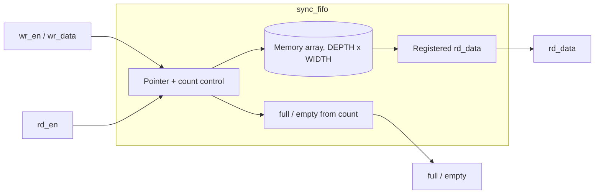

# Synchronous FIFO: Formal Verification with RTL Bug Injection


A portfolio project that implements a parameterized synchronous FIFO in SystemVerilog, specifies its behavior with SystemVerilog Assertions (SVA), and measures how well those assertions catch deliberately injected RTL bugs.

> **Honesty note:** No formal pass or bug-detection result is claimed until it has been run in the target tool and the logs are saved under `reports/`. Anything marked *Pending* below is not yet verified.

---

## Table of Contents
1. [Project Goals](#project-goals)
2. [Design Overview](#design-overview)
3. [Interface](#interface)
4. [Design Contract](#design-contract)
5. [Repository Layout](#repository-layout)
6. [Quick Start](#quick-start)
7. [Formal Verification Flow](#formal-verification-flow)
8. [Property Catalog](#property-catalog)
9. [Bug Injection Workflow](#bug-injection-workflow)
10. [Bug Detection Matrix](#bug-detection-matrix)
11. [Evidence Checklist](#evidence-checklist)
12. [Assumptions and Limitations](#assumptions-and-limitations)
13. [Roadmap](#roadmap)
14. [Status](#status)

---

## Project Goals
- Implement a synthesizable synchronous FIFO in SystemVerilog.
- Specify reset, occupancy, full/empty, and pointer invariants as assertions.
- Inject representative RTL bugs and document which properties detect them.
- Keep portable simulation checks separate from Synopsys VC Formal setup.
- Save proof logs and counterexamples as reproducible evidence.

## Design Overview



Key design choices:
- **Count-derived status:** `full` and `empty` are derived from an occupancy counter, which makes the occupancy invariants easy to state and check.
- **Registered read data:** `rd_data` updates only on an accepted read.
- **Independent accepts:** a simultaneous read and write are each judged against the pre-edge `full` and `empty` flags.

## Interface

| Signal    | Dir | Width            | Description                                   |
|-----------|-----|------------------|-----------------------------------------------|
| `clk`     | in  | 1                | Single clock domain                           |
| `rst_n`   | in  | 1                | Active-low synchronous reset                  |
| `wr_en`   | in  | 1                | Write request                                 |
| `wr_data` | in  | `WIDTH`          | Write data                                    |
| `rd_en`   | in  | 1                | Read request                                  |
| `rd_data` | out | `WIDTH`          | Registered read data                          |
| `full`    | out | 1                | FIFO cannot accept writes                     |
| `empty`   | out | 1                | FIFO has no data to read                      |
| `count`   | out | `$clog2(DEPTH)+1`| Current occupancy (if exposed for properties) |

**Parameters**

| Parameter | Default | Constraint                                       |
|-----------|---------|--------------------------------------------------|
| `WIDTH`   | 8       | >= 1                                             |
| `DEPTH`   | 8       | >= 2, power of two in this starter version       |

> Adjust names and defaults to match `rtl/sync_fifo.sv`.

## Design Contract
- Single clock; active-low synchronous reset (`rst_n` is sampled on `posedge clk`).
- `DEPTH` must be at least 2 and is expected to be a power of two in this starter version.
- A write is accepted when `wr_en && !full`.
- A read is accepted when `rd_en && !empty`.
- A simultaneous read and write are independently accepted according to the pre-edge `full` and `empty` flags.
- Reads while empty and writes while full are ignored.
- `rd_data` is registered and updates only on an accepted read.
- Reset clears pointers, count, flags (through the count-derived status), and output data.

## Repository Layout
```text
rtl/
  sync_fifo.sv              # Clean reference design
  bug_variants/
    fifo_bug_full.sv        # Bug: full-flag defect
    fifo_bug_count.sv       # Bug: occupancy-counter defect
formal/
